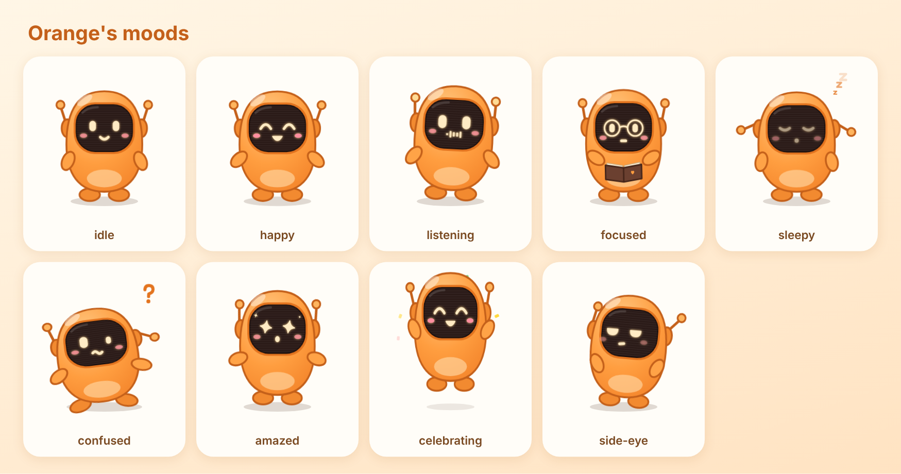
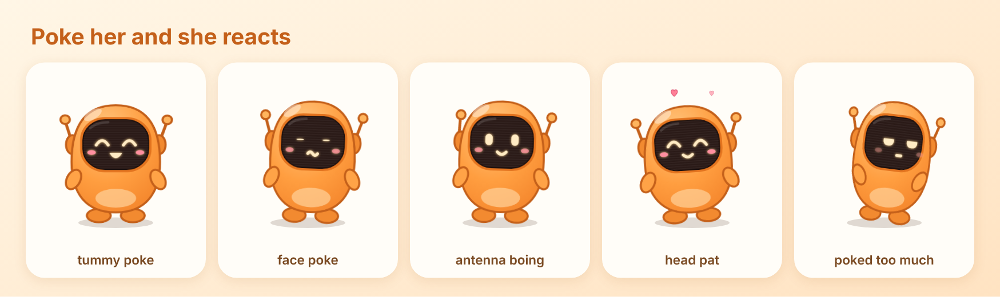
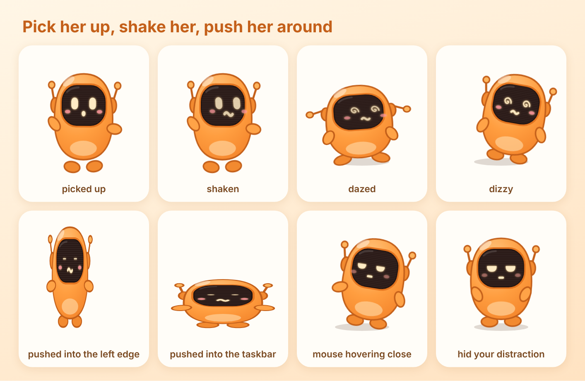

<h1 align="center">🍊 Orange</h1>

<p align="center">
  <b>A tiny study buddy who lives on your screen.</b><br>
  She studies with you, notices when you drift, and reacts when you poke her.<br>
  Everything runs on your own laptop.
</p>

<p align="center">
  
</p>

---

## Why Orange exists

Most focus apps work *at* you: a timer rings and that is it.
Orange works *with* you. Tell her what you are studying and she sits in the corner of
your screen with her own tiny book and reads alongside you. When you take a break, so does she.
When the session ends, she celebrates.

She is a companion, not a tutor. She will not explain eigenvalues. She will sit with you while you learn them.

## What she does

| | |
|---|---|
| 📖 **Studies with you** | "Study DL for 45 minutes" and she puts on glasses and reads beside you, with a timer under her feet. |
| 🗣️ **Listens** | Say "Hey Orange", double-click her, or press `Ctrl+Space`. Speech is turned into text on your laptop. |
| 🧠 **Understands everyday sentences** | "I'm starving, gonna grab a bite" pauses your session. Rules handle the common sentences instantly; a small local language model handles the rest. |
| 👀 **Notices distractions** | During a session she reads the tab title and site name of the browser page in front. Study sites, AI chats and class pages are fine; if it is clearly entertainment, she hides (minimises) it and fills the screen for a few seconds. She never closes anything. |
| 🎓 **Learns from you** | "When I say grind, I mean study for 45 minutes." She remembers it. Tell her "this is for study" and she stops flagging that page. |
| ⏰ **Remembers** | Reminders, notes, and a session that picks up where it left off if you close her. |
| 🫳 **Reacts to touch** | Poke her tummy, boing an antenna, pat her head, pick her up, shake her, push her into the edge of the screen. |

<p align="center">
  
</p>

<p align="center">
  
</p>

<sub>The pictures above are drawn by Orange's own code (`orange/face/`), captured as still frames. On screen she is always moving.</sub>

## Private by design

- **No cloud.** The language model runs locally through [Ollama](https://ollama.com). Speech-to-text runs locally through Whisper.
- **No recordings.** Audio stays in memory and is never written to disk.
- **Titles and site names only.** The distraction watch reads the window title and, in browsers, the site name from the address bar (for example `chatgpt.com`). It never looks inside a page, runs only during a study session, and saves nothing except pages or sites you mark as "for study".
- **One small database file** (`data/orange.db`, SQLite) holds your sessions, reminders, notes and taught phrases. It never leaves your machine and is excluded from git.

## How she works

```
 you speak / type / click
          │
          ▼
   ┌─────────────┐   known sentence    ┌───────────────┐
   │ taught       │ ─────────────────▶ │               │
   │ phrases      │                    │    Buddy      │──▶ mood, timer, speech bubble
   │ + rules      │   unknown sentence │ (study_mode)  │
   └─────────────┘ ──▶ local brain ──▶ │               │
                        (Ollama)       └───────┬───────┘
                                               │
   window in front ──▶ watch ──▶ brain judges ─┘──▶ hide the window
                                               │
                                          SQLite memory
```

| Part | File | What it is |
|---|---|---|
| Face | `orange/face/` | The character, drawn entirely in SVG + CSS (no image files), inside a transparent always-on-top PyQt6 window |
| Buddy | `orange/study_mode.py` | Sessions, breaks, pauses, reminders. Plain rules, no window code, so it can be tested alone |
| Rules | `orange/commands.py` | Turns a sentence into a command with pattern matching |
| Brain | `orange/brain.py` | A small local model that may only pick one of Orange's own actions |
| Watch | `orange/watch.py` | Reads the front window's title and hides distractions |
| Voice | `orange/voice.py` | "Hey Orange" and speech-to-text |
| Memory | `orange/store.py` | The only file that touches the database |

## Run her

**Needs:** Windows 10 or 11, Python 3.11, a microphone (optional), and [Ollama](https://ollama.com) (optional, for the brain).

```powershell
git clone https://github.com/MythDroid/ORANGE---focus-buddy.git
cd ORANGE---focus-buddy
py -3.11 -m venv venv
.\venv\Scripts\Activate.ps1
pip install -r requirements.txt
ollama pull qwen3.5:2b
python pet.py
```

Without Ollama she still works with her rules and taught phrases.
Every feature has a switch in `config.yaml` (voice, "Hey Orange", the shortcut, the watch, her size).

## Things to say

| Say or type | She does |
|---|---|
| `study DL for 45 minutes` | Starts a session and studies with you |
| `break 5` | A five minute break, then calls you back |
| `I'm going for dinner` … `I'm back` | Pauses with no time limit, then carries on |
| `remind me in 10 minutes to drink water` | Reminds you |
| `remember that my exam is on Monday` | Saves it. `what do you remember` reads it back |
| `when I say grind, I mean study for 45 minutes` | Learns your own phrase |
| `this is for study` | Brings back a window she hid, and remembers it is fine |
| `call me princess` | Uses that name |

## Status

Orange is an early personal project and is changing quickly.

- Windows only for now. The distraction watch and the shortcut use Windows APIs.
- The session logic, rules and memory are tested without a window, using a simulated clock.
- The window, voice and touch reactions are tested by hand on one laptop.
- A small local model makes mistakes. Where a wrong guess could start a timer, Orange's code double-checks it, and you can always correct her.

Every change is listed in [CHANGELOG.md](CHANGELOG.md).

## What is next

- Activity buddy: she paints when you draw, types when you code
- Teach mode: explain a topic to her out loud, and she asks you to teach it again a few days later
- Idle life: fidgets when bored, a sleeping cap at night
- A desktop shortcut so she starts with a double-click

---

<p align="center">Made by <a href="https://github.com/MythDroid">Mythrayee</a> 🍊</p>
